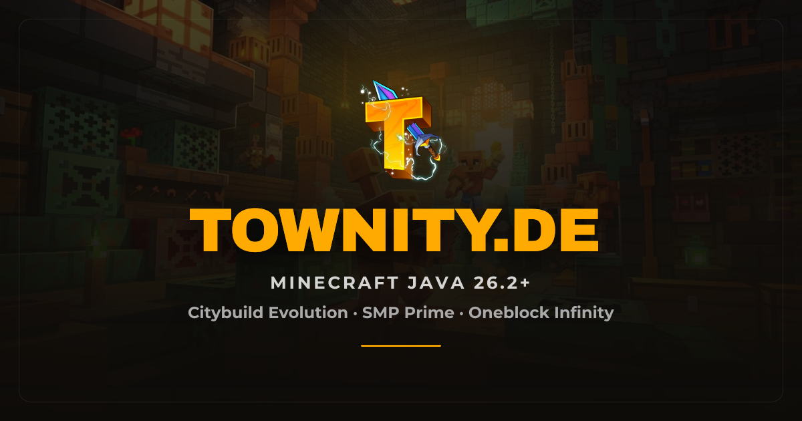

   

  

    

  

    <strong>Minecraft-Netzwerk</strong> · gebaut von Grund auf 
    Eigenes Ökosystem. Eigene Systeme. Eigene Standards.
  

  

    <a href="https://townity.de">Website</a>
    ·
    <a href="https://wiki.townity.de">Wiki</a>
    ·
    <code>townity.de</code>
  

   

  

    Wir schreiben Software für ein ganzes Netzwerk — 
    Proxy, Spielserver, Economy, Community und mehr. 
    Kein Copy-Paste-Server. Kein zusammengewürfelter Plugin-Zoo.
  

   

  

    <em>Qualität, die man merkt. Performance, die hält. Design, das sitzt.</em>
  

   

  

    <a href="https://townity.de"><strong>→ townity.de</strong></a>
  

   

